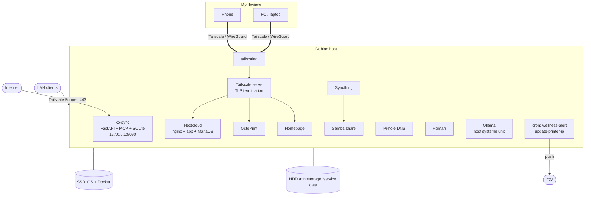

# Homelab

A single-node, Docker-based home server that I build, run and maintain: personal cloud storage, phone backup, network-wide DNS filtering, 3D-printer remote access, the backend for an Android app I wrote (which doubles as an MCP server for Claude), and the monitoring and hardening around all of it.

This repo documents how it is built and why. Everything under `stacks/`, `scripts/` and `host/` is a sanitized copy of what is actually running: secrets, IP addresses, MAC addresses and the tailnet name are replaced by placeholders.

## Contents

1. [At a glance](#at-a-glance)
2. [Architecture](#architecture)
3. [Services](#services)
4. [Networking and access](#networking-and-access)
5. [Storage and data layout](#storage-and-data-layout)
6. [Host layer](#host-layer)
7. [Monitoring and automation](#monitoring-and-automation)
8. [Security](#security)
9. [Design decisions and lessons](#design-decisions-and-lessons)
10. [Repo layout](#repo-layout)
11. [Reproducing it](#reproducing-it)

## At a glance

| | |
|---|---|
| Hardware | AMD Ryzen 5 2600 (6C/12T), 16 GB RAM, 207 GB SSD (OS) + 4.6 TB HDD (data) |
| OS | Debian 13, kernel 6.12 |
| Runtime | Docker + Compose, one compose project per service |
| Remote access | Tailscale for private access, Tailscale Funnel for one public endpoint |
| Monitoring | Cron-driven health checks, push alerts through ntfy, Glances |
| Hardening | SSH keys only, no root login, fail2ban, ufw, unattended upgrades, Lynis audits |
| Idle footprint | About 2.6 GB of 16 GB RAM for the whole stack |

## Architecture



The design rules are few and applied everywhere:

- **One compose project per service**, so each can be rebuilt, broken or moved without touching the others.
- **Data on the big disk**, in `/mnt/storage/<service>/`, as bind mounts. Backing up or migrating a service is copying one directory.
- **Nothing is port-forwarded on the router.** Private services are reached over Tailscale. The single public endpoint goes through Tailscale Funnel.
- **Containers bind to localhost** wherever possible, and Tailscale publishes them. Docker's `restart: unless-stopped` plus a boot-ordering-safe design means the box recovers from a reboot unattended.

## Services

| Service | Purpose | Reached via | Config |
|---|---|---|---|
| Nextcloud + MariaDB + nginx | Personal cloud storage | Tailnet HTTPS, LAN :8080 | [`stacks/nextcloud`](stacks/nextcloud) |
| Syncthing | Phone-to-server photo and file backup | LAN / tailnet, UI :8384 | [`stacks/syncthing`](stacks/syncthing) |
| Samba | Exposes the synced files as a network share | LAN :445 | [`stacks/samba`](stacks/samba) |
| Pi-hole | Network-wide DNS filtering | LAN / tailnet, :53 | [`stacks/pihole`](stacks/pihole) |
| ko-sync | Backend for my Android app and an MCP server for Claude | Public (Funnel) | [`stacks/ko-sync`](stacks/ko-sync) |
| OctoPrint + mjpg-streamer | USB-connected 3D printer and webcam | Tailnet HTTPS | [`stacks/octoprint`](stacks/octoprint) |
| OctoEverywhere companion + socat | Remote access to a LAN-attached printer | Outbound + tailnet proxy | [`stacks/elegoo-connect`](stacks/elegoo-connect) |
| Homarr | Service launcher dashboard | LAN / tailnet, :7575 | [`stacks/Homarr`](stacks/Homarr) |
| Ollama | Local LLM runtime for a side project (host service, CPU only) | LAN / tailnet, :11434 | [`host/ollama.service`](host/ollama.service) |
| Glances | System metrics web UI (host service) | LAN / tailnet, :61208 | n/a |

Notes on the less obvious ones:

**Nextcloud.** MariaDB 11 with `READ-COMMITTED` isolation and row-based binary logging, as Nextcloud recommends. An nginx reverse proxy raises the upload limit to 10 GB and extends timeouts for big transfers. The app has a fixed container IP on a dedicated subnet, so the proxy config does not depend on Docker DNS.

**Syncthing and Samba.** Syncthing is the phone backup path: peer-to-peer, and a failing folder is visible in its UI. Samba exposes the received folder on the LAN so the same files are reachable from Windows without a second copy.

**ko-sync.** The backend for a personal Android kitchen and fitness app I wrote in Kotlin ([source](https://github.com/Lucca-Pereira/KO)). The phone is the source of truth and syncs its Room database to this service over HTTPS with a bearer token. The same service is a FastMCP server, so Claude can read and write pantry, recipes, meal plans and food logs from chat, authenticated with Google OAuth restricted to an email allow-list. Python 3.12, FastAPI, SQLite on a Docker volume. It is the only publicly reachable service.

**Printers.** OctoPrint drives a printer over USB serial, with a separate container streaming the webcam. A second, network-attached printer is reached through the OctoEverywhere companion plus a small `socat` container that forwards the printer's port onto the Tailscale address. That printer gets a new DHCP lease on every power-on, so a cron script keeps the config pointed at it (see [monitoring](#monitoring-and-automation)).

**Ollama.** Runs on the host as a user-level systemd unit rather than in Docker, with lingering enabled so it starts at boot without a login. Models stay warm for 30 minutes after use.

## Networking and access

Three ways in:

| Path | What uses it | Notes |
|---|---|---|
| Tailscale (WireGuard) | All my own devices, anywhere | Private; the default for everything |
| Tailscale Funnel | ko-sync only | Public HTTPS on port 443, forwarded to `127.0.0.1:8090` |
| LAN | Devices at home | Pi-hole DNS, Samba, direct service ports |

How services are published on the tailnet (`host/tailscale-serve.sh`):

| Tailnet HTTPS port | Backend | Service | Audience |
|---|---|---|---|
| 443 | `localhost:8090` | ko-sync | Public (Funnel) |
| 8444 | `localhost:8080` | Nextcloud | Tailnet only |
| 10000 | `localhost:5000` | OctoPrint | Tailnet only |
| 3443 | `localhost:3000` | Homepage | Tailnet only |

Tailscale terminates TLS and provides the certificates, so no certificate management on the host.

Why `ko-sync` binds to `127.0.0.1` rather than the Tailscale IP: an earlier version bound to the Tailscale address, and after a reboot Docker sometimes started before `tailscaled` had brought the address up. The bind failed and the container exited for good. Localhost always exists, and Funnel forwards to it.

Pi-hole, Homarr and Homepage use host networking: Pi-hole needs real client addresses and the host's interfaces, and the dashboards need to reach other host services.

## Storage and data layout

| Disk | Size | Holds |
|---|---|---|
| SSD (`/`) | 207 GB | OS, Docker images and containers, compose files in `~/docker/<service>/` |
| HDD (`/mnt/storage`) | 4.6 TB | Per-service data: Nextcloud, Syncthing, Pi-hole, OctoPrint, Homepage config, printer companion state |

- Compose files: `~/docker/<service>/docker-compose.yml`
- Data: `/mnt/storage/<service>/`
- Containers run as uid/gid 1000 where the image supports `PUID`/`PGID`, so data stays owned by my user rather than root.
- Bind mounts are used for anything I care about. The exceptions are the Nextcloud database and ko-sync's SQLite file, which live on named Docker volumes.

**Backups.** There is no off-site backup. Protection today is replication: phone photos exist on the phone and on the server through Syncthing, and code lives in Git. A proper 3-2-1 backup is the biggest open gap and is listed under [security](#security).

## Host layer

Not everything is a container. Services on the host itself:

| Component | Role |
|---|---|
| `tailscaled` | Private networking, serve and Funnel |
| `sshd` | Key-only login, root login disabled |
| `ufw` | Host firewall |
| `fail2ban` | Bans repeated failed logins |
| `unattended-upgrades` | Automatic security updates |
| `glances` | Metrics web UI, feeds the dashboards |
| `ollama` (user unit) | Local LLM runtime |
| `cron` | Alerting and self-healing jobs, see `host/crontab` |

## Monitoring and automation

Three cron jobs (`host/crontab`):

| Schedule | Job | Purpose |
|---|---|---|
| Every 5 min | `wellness-alert` | Check the box, push to my phone if something is wrong |
| Daily 09:00 | `wellness-alert --heartbeat` | "All OK" summary, so silence means the monitor is broken |
| Every 2 min | `update-printer-ip.sh` | Keep the printer companion pointed at the printer's current IP |

**wellness-alert** ([`scripts/wellness-alert`](scripts/wellness-alert)) checks disk (85%), memory (90%), CPU temperature (80 C), load per core, failed systemd units (system and user) and containers that are restarting, exited or unhealthy. It tracks open problems on disk: it alerts once when a problem appears, re-alerts every 6 hours if still open, and sends a recovery message when it clears, rather than paging every 5 minutes. Intentionally stopped services (OctoPrint between prints) are on an ignore list. It has `--dry` and `--test` flags, and the ntfy topic is stored outside the repo because the topic name is effectively the password.

**wellness-check** ([`scripts/wellness-check`](scripts/wellness-check)) is the interactive version: one command printing uptime, load, memory, disk, failed units, container health, temperatures, top processes and recent journal errors.

**update-printer-ip** ([`scripts/update-printer-ip.sh`](scripts/update-printer-ip.sh)) does a cheap TCP probe of the last known address. Only if that fails does it scan the subnet (nmap in a throwaway container), find the printer by MAC in the neighbour table and rewrite the compose file. The expensive path is rare.

The split is deliberate: boring, frequent faults (a DHCP lease changing) are fixed automatically; anything else (full disk, crash loop, failed unit) pages me instead of being silently auto-fixed.

## Security

**Auditing.** I audit the host with [Lynis](https://cisofy.com/lynis/); the current hardening index is 71 out of 100. I treat the remaining suggestions as a backlog rather than a finished job.

## Repo layout

```
stacks/        sanitized docker-compose files, one folder per service
scripts/       health-check, alerting and self-healing scripts
host/          crontab, Tailscale publishing commands, Ollama systemd unit
docs/          longer write-ups of the sections above
.env.example   names of the secrets each stack expects
```

## Reproducing it

Each stack is independent. Copy a folder, create a `.env` from `.env.example`, create its data directory with `sudo mkdir -p /mnt/storage/<service> && sudo chown 1000:1000 /mnt/storage/<service>`, and run `docker compose up -d`. Replace placeholders such as `<TAILSCALE_IP>`, `<PRINTER_IP>`, `<PRINTER_MAC>`, `<LAN_SUBNET>` and `<HOST>.<TAILNET>` with your own values. Then apply `host/tailscale-serve.sh` and install `host/crontab`.
